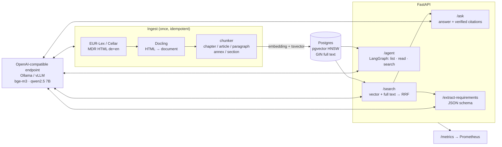

# rag-requirements-demo

Hybrid RAG, requirement extraction and a small research agent over the EU Medical Device
Regulation (MDR, Regulation (EU) 2017/745), in German and English. All models run
self-hosted behind an OpenAI-compatible endpoint (Ollama locally, vLLM in a cluster):
no cloud API, no cost per request.

It is a demo, not a product: every part is small, tested and explained.

- **Ingest**: EUR-Lex HTML → Docling → chunks along the legal structure
  (`MDR/Kapitel-II/Art-10/Abs-9`), each with an embedding (bge-m3) and a `tsvector` in Postgres.
- **Retrieval** without a framework: pgvector HNSW + Postgres full text, fused by Reciprocal Rank Fusion.
- **API** (FastAPI): `/search`, `/ask` with verified citations and an honest "not found",
  `/extract-requirements` with schema-constrained JSON.
- **Agent** (LangGraph): browses the regulation like a file tree (`list`/`read`/`search`),
  reads whole articles and marks its own conclusions.
- **Evaluation**: recall@5 and MRR@10 for vector, full-text and hybrid retrieval.
- **Operations**: Docker Compose, health checks, Prometheus metrics, Kustomize manifests that
  CI deploys to a kind cluster and smoke-tests.

## Architecture



## Quickstart

Needs Docker and [uv](https://docs.astral.sh/uv/). The first start pulls the models
(bge-m3 1.2 GB, qwen2.5:7b-instruct 4.7 GB) into a Docker volume.

```sh
docker compose up -d --build          # API on :8000, Postgres on :5432, Ollama on :11434
uv sync --all-extras
uv run --extra ingest python -m mdr_rag.ingest   # fetch, chunk, embed (CPU: ~1 h, resumable)
scripts/demo                           # terminal tour of all endpoints
```

The default chat model is `qwen2.5:7b-instruct`. It needs about 6 GB of free RAM on a CPU;
with less, set `CHAT_MODEL=qwen2.5:3b-instruct` in `.env` (the examples below were produced
with the 3B model on a busy laptop).

Interactive API docs: <http://localhost:8000/docs>. Ports and models can be changed in `.env`
(`POSTGRES_PORT`, `OLLAMA_PORT`, `API_PORT`, `EMBED_MODEL`, `CHAT_MODEL`); the Python side
reads `DATABASE_URL`, `LLM_BASE_URL`, `EMBED_MODEL`, `CHAT_MODEL` (`uv run --env-file .env ...`).

Tests need Docker (Testcontainers starts pgvector) but no model:

```sh
uv run ruff check . && uv run pytest
```

## Examples

Output of `scripts/demo` against the Compose stack (qwen2.5:3b-instruct, abridged).

**`GET /search`** – each hit shows its rank in both retrievers:

```text
MDR/Anhang-IX/Kapitel-I/Abschnitt-1  rrf=0.03  ranks={"vector":3,"fulltext":12}
MDR/Kapitel-II/Art-10/Abs-2          rrf=0.03  ranks={"vector":12,"fulltext":3}
...
```

**`POST /ask`** `{"question": "Wie lange muss der Hersteller die technische Dokumentation aufbewahren?"}`

```json
{
  "lang": "de",
  "found": true,
  "answer": "Der Hersteller muss die technische Dokumentation mindestens zehn Jahre nach dem letzten Produkt in Verkehr gebracht wurde zur Verfügung stellen [MDR/Kapitel-II/Art-10/Abs-8]. Bei implantierbaren Produkten beträgt dieser Zeitraum jedoch mindestens 15 Jahre ab Inverkehrbringen des letzten Produkts.",
  "citations": [
    {
      "path": "MDR/Kapitel-II/Art-10/Abs-8",
      "heading": "Artikel 10 – Allgemeine Pflichten der Hersteller",
      "url": "https://eur-lex.europa.eu/legal-content/DE/TXT/HTML/?uri=CELEX:32017R0745#art_10"
    }
  ]
}
```

`{"question": "Wie backe ich ein Sauerteigbrot?"}` returns `"found": false` and
"Dazu habe ich in der MDR nichts gefunden." without a model call.

**`POST /extract-requirements`** `{"topic": "Anforderungen an Software als Medizinprodukt"}`

```text
Anhang-I/Kapitel-II/Abschnitt-17#1  [manufacturer]  Produkte, zu deren Bestandteilen programmierbare Elektroniksysteme, einschließlich Software, gehören, oder Produkte in Form einer Software werden so ausgelegt, dass Wiederholbarkeit, Zuverlässigkeit und Leistung entsprechend ihrer bestimmungsgemäßen Verwendung gewährleistet sind.
Anhang-I/Kapitel-II/Abschnitt-17#2  [manufacturer]  Bei Produkten, zu deren Bestandteilen Software gehört, oder bei Produkten in Form einer Software wird die Software entsprechend dem Stand der Technik entwickelt und hergestellt, wobei die Grundsätze des Software-Lebenszyklus, des Risikomanagements einschließlich der Informationssicherheit, der Verifizierung und der Validierung zu berücksichtigen sind.
Anhang-I/Kapitel-II/Abschnitt-17#3  [manufacturer]  Die Hersteller legen Mindestanforderungen bezüglich Hardware, Eigenschaften von IT-Netzen und IT-Sicherheitsmaßnahmen einschließlich des Schutzes vor unbefugtem Zugriff fest, die für den bestimmungsgemäßen Einsatz der Software erforderlich sind.
Kapitel-I/Art-1/Abs-3#1             [manufacturer]  Produkte mit medizinischer und nicht-medizinischer Zweckbestimmung müssen sowohl die Anforderungen an Produkte mit medizinischer Zweckbestimmung als auch die Anforderungen an Produkte ohne medizinische Zweckbestimmung erfüllen.
...
```

Each item is JSON with `id`, `statement`, `addressee`, `source` (path) and `url` (EUR-Lex anchor).
`{"article": "Art. 10"}` extracts a whole article instead.

**`POST /agent`** `{"question": "Which obligations does an importer have before placing a device on the market?"}`

```text
  search {"query":"importer obligation MDR"}
  read {"path":"MDR/Chapter-II/Art-13"}

Based on [MDR/Chapter-II/Art-13], importers have several obligations before placing a device on the market:
1. Compliance with Regulation: Importers must place only devices that are in conformity with this Regulation (Article 13, Para-1).
2. Verification of CE Marking and Declaration of Conformity: They need to verify that the device has been CE marked, ...
3. Registration: Importers need to verify that the device is registered in the electronic system as per Article 29 ...
...
```

## Evaluation

`eval/questions.toml` holds 39 questions (21 German, 18 English), each with the articles or
annexes that answer it, plus 4 off-topic questions. 27 are natural-language paraphrases; 12
are built around an exact term: an identifier ("Basis-UDI-DI"), a classification rule
("Regel 11", "Rule 8"), an article or annex number, a directive ("93/42/EWG"). A hit counts if
its article/annex is one of the expected ones. Reproduce with
`uv run python -m mdr_rag.evaluate` against an ingested database.

Embeddings bge-m3 via Ollama 0.16.2, 1510 chunks (762 de, 748 en), 2026-10-27,
recall@5 / MRR@10:

| Retriever | paraphrase (27) | exact term (12) | all (39) |
|---|---|---|---|
| vector (HNSW, cosine) | 1.00 / 0.98 | 1.00 / 0.85 | 1.00 / 0.94 |
| full text, `ts_rank_cd` | 0.70 / 0.54 | 0.75 / 0.71 | 0.72 / 0.59 |
| full text, `ts_rank_cd` normalised by length (default) | 0.85 / 0.78 | 0.83 / 0.56 | 0.85 / 0.71 |
| hybrid (RRF, k=60) with raw full text | 1.00 / 0.92 | 0.92 / 0.80 | 0.97 / 0.88 |
| hybrid (RRF, k=60) with normalised full text | 0.96 / 0.90 | 0.92 / 0.78 | 0.95 / 0.86 |
| hybrid plus named references resolved first (default) | 0.96 / 0.90 | 1.00 / 1.00 | 0.97 / 0.93 |

What the numbers say:

- **Vector search alone is best, on paraphrases and on exact terms.** The exact-term questions
  were added to find the case where full text wins; on this corpus it does not. bge-m3 is
  multilingual and has seen enough regulatory text to place "Basis-UDI-DI" or "Regel 21"
  correctly. It ranks a little worse on exact terms (MRR 0.85) but still finds every answer
  in the top 5.
- **Postgres full text has no IDF.** `ts_rank_cd` weighs every matching word the same, so in
  "What does Article 117 amend?" the word "article", which occurs in hundreds of chunks,
  counts as much as "117". Article 117 does not reach the top 10, and fusion pushes it out of
  the hybrid top 5 as well, although vector search has it at rank 1. A BM25 ranking (for
  example the ParadeDB `pg_search` extension) would be the next thing to measure.
- **Named references are looked up, not searched for.** A question that names an article, an
  annex or a classification rule ("Artikel 120", "Annex XVI", "Rule 8") gets the chunks of
  that unit first, most similar first, on up to half of the places; the search results fill
  the rest. That lifts the exact-term column to 1.00 / 1.00. Read that number with care: six
  of the twelve questions name the unit they expect, so for them it shows that the lookup
  works, not that retrieval got better. The paraphrases name no reference and are unchanged.
- **Length normalisation is a trade-off.** Raw `ts_rank_cd` favours long chunks: annex
  sections and the definitions article contain most query words somewhere and outrank the
  short paragraph that answers. Dividing by length fixes that for paraphrases (MRR
  0.54 → 0.78) but hurts exact terms (0.71 → 0.56): "Regel 11" sits in a long section of
  Annex VIII and loses to short paragraphs that contain an "11". German compounds stay a
  weak spot ("Implantatausweis" vs. "Implantationsausweis").
- **Hybrid stays the default** because the API cannot know which kind of query comes next,
  and it is the safer choice for a different embedding model or a smaller one. On this set it
  costs a little ranking quality. A reranker or weighted fusion would be worth measuring
  against a larger, independent question set (tuning on this one would overfit).
- **Off-topic detection has almost no margin.** The best vector similarity is 0.31–0.43 for
  off-topic questions and 0.44–0.81 for on-topic ones. `/ask` answers "not found" below 0.5
  without calling the model. That caught all off-topic questions but also three short
  reference questions ("Was besagt Regel 11?" 0.44, "Was regelt Artikel 120?" 0.49, "What
  does Rule 8 cover?" 0.50): short questions carry little meaning for the embedding. A
  question whose named reference exists in the corpus now skips the threshold; with that no
  on-topic question of the set is rejected.
- Answer quality is not scored automatically; the citation check (only passages that were in
  the context can be cited) is the guard rail.

## Design decisions

- **Chunks follow the law, not a token window.** A chunk is a paragraph of an article or a
  top-level section of an annex; its path is the citation. Long units are split at point
  boundaries. Docling turns the EUR-Lex HTML (or a PDF) into one document model, so the
  chunker only walks headings and paragraphs.
- **Retrieval is plain SQL.** Vector search (HNSW, cosine) and full-text search (german/english
  stemming) each return 50 candidates; Reciprocal Rank Fusion merges them by rank, so the two
  score scales never need calibrating. The pipeline is a cascade: cheap stages with high recall
  first, the expensive and precise step (the LLM reading whole passages) last on a handful of
  survivors. A cross-encoder reranker would be the next stage; Ollama has no rerank API, so it
  is left out rather than bolted on. In front of the cascade, articles, annexes and rules
  named in the question are resolved with a regular expression and looked up directly.
- **The full-text query ORs the question's lexemes.** `websearch_to_tsquery` ANDs every word of
  a natural question and rarely matches; OR plus `ts_rank_cd` keeps recall high and rewards
  passages where the terms co-occur.
- **Grounding is checked, not hoped for.** `/ask` and `/agent` only keep citations of passages
  the model actually received; invented paths are removed from the text. Off-topic questions
  (best vector similarity below a threshold calibrated in the evaluation) are answered with
  "not found" without calling the model, and the model may itself answer `NOT_FOUND`.
- **Provenance markers.** Statements that are the model's own conclusion end with
  "(inferred)" / "(gefolgert)", everything else carries a citation.
- **Structured extraction.** `/extract-requirements` sends a JSON schema to the endpoint
  (constrained decoding in Ollama and vLLM) and validates the result with Pydantic. Each
  requirement has an addressee from a fixed list and a stable ID derived from its source
  path (`Kapitel-II/Art-10/Abs-9#2`); items whose source was not in the context are dropped
  and counted.
- **The agent reads, it does not get fed.** Instead of top-k snippets the agent sees the
  regulation as a read-only tree and pulls whole articles. Tool rounds are capped (4); after
  that it must answer with what it has read.
- **Small and replaceable.** One OpenAI-compatible endpoint for embeddings and chat, so
  Ollama on a laptop and vLLM on a GPU node are a config change. LangGraph only for the agent;
  retrieval and prompting are ~400 lines of own code.

## Kubernetes

`deploy/k8s` is a Kustomize base: namespace, Postgres/pgvector StatefulSet, API Deployment
and Service with readiness (`/readyz`, checks the database) and liveness (`/healthz`) probes,
Prometheus scrape annotations, a ConfigMap for model settings and a placeholder Secret. The
API image runs as an arbitrary non-root UID with group 0, read-only root filesystem and no
capabilities, as OpenShift requires.

```sh
docker build -t mdr-rag:local . && kind load docker-image mdr-rag:local
kubectl apply -k deploy/k8s
```

CI does exactly this in a kind cluster and smoke-tests readiness, full-text search, the
OpenAPI document and the metrics endpoint. The cluster has no model server; point
`LLM_BASE_URL` in the ConfigMap at a vLLM or Ollama Service and replace the Secret with one
from a secret store. Ingest runs as a one-off job against the same database.

## Limits

- Not legal advice. Answers come from a 3–7B model and can be incomplete or wrong (in an
  earlier run of the agent example below it read Article 16 instead of Article 13); the citations are the part
  to trust.
- The corpus is the MDR as published in the Official Journal (OJ L 117, 5.5.2017), without
  later amendments and corrigenda (e.g. 2020/561, 2023/607). Recitals, footnotes and the
  correlation table (Annex XVII) are not indexed.
- Small local models on a CPU are slow: on the busy laptop used here `/ask` took 1–5 minutes and
  the whole `scripts/demo` 13–35 minutes, depending on the load. A GPU node with vLLM is the
  intended runtime; extraction of a whole long article can hit the 10-minute client timeout
  on a CPU. Ollama runs with an 8k
  context, which bounds how much the agent can read.
- Terse questions without a named reference can still fall below the off-topic threshold of
  `/ask`: "Was ist ein PRRC?" reaches 0.35, the abbreviation does not occur in the
  regulation. A full sentence that names the subject is safer. Reference
  resolution only knows articles, annexes and the rules of Annex VIII, not paragraphs
  ("Artikel 10 Absatz 9") or sections.
- The evaluation measures retrieval only, on a small hand-written set; answer quality is not
  scored automatically.
- No auth, no multi-tenancy, no UI: the FastAPI docs and `scripts/demo` are the interface.

## Data and license

The MDR text is fetched at ingest time from the EU Publications Office (the Cellar API behind
[EUR-Lex](https://eur-lex.europa.eu/eli/reg/2017/745/oj)) and is not part of this repository.
© European Union, <https://eur-lex.europa.eu>; reuse is authorised under
[Commission Decision 2011/833/EU](https://eur-lex.europa.eu/eli/dec/2011/833/oj). Only
legislation published in the Official Journal is used; no copyrighted standards (ISO, IEC).

Code: [MIT](LICENSE).
